# Tasks, Teams and Navigation — proposal and prototypes

A proposal to start a conversation, not a finished design. Nothing here is implemented, and no application code changes.

## The specs

| Spec | What it covers |
|---|---|
| [Tasks module](../2026-10-19-tasks-module-design.md) | Tasks, slots, openness, endorsement, capabilities (task-gated permissions), milestones, production calendar, Get involved, production view |
| [Teams on tasks](../2026-10-19-teams-on-tasks-design.md) | How Teams becomes the first host: coordination, contact point, meetings, derived membership, migration |
| [Meetings](../2026-10-19-meetings-design.md) | One capability for team, workgroup, project and community meetings: agenda, scheduling poll, attendance, notes |
| [Shifts improvements](../2026-10-19-shifts-improvements-design.md) | A starting list: attendance confirmation, bail timing, history for the track record, and how Shifts meets the new model |
| [Concerns](../2026-10-19-concerns-design.md) | Raising and handling concerns, mediation, deselection panels — data and tasks, not hardcoded |
| [Navigation](../2026-10-19-navigation-design.md) | A top bar that does not grow, go-to search, bottom tab bar on phones, page actions that stay in reach |

Facts about Humans in these specs were checked on 2026-10-19 against `nobodies-collective/Humans` main at commit `238416555`, which this branch was cut from. The Requests section of the Tasks spec is a first proposal and much less explored than the rest.

Each spec marks its undecided points as **[OPEN]**. The specs touch areas reserved for the maintainer (new public surface, the capability and privilege model, dropping role tables), so they are meant for discussion before any implementation.

They are in `docs/superpowers/specs/` on purpose: files in `docs/features/global/` and in a section's `Docs/features/` are served to members by the in-app Agent as feature specs, and these describe things that do not exist yet.

## The prototypes

Static HTML with fake data. They load the application's real `tokens.css` and `site.css`, so the look is Humans' own; only the components in `_proto.css` / `nav.css` are proposals. To view them, serve the repository root and open the index pages:

```bash
python3 -m http.server 8765        # from the repository root
```

- `…/tasks/index.html` — team page (switch Visitor / Contributor / Holder / Coordinator), task page, Get involved, production view
- `…/navigation/index.html` — group menus, go-to search (Ctrl/Cmd-K), local strip, phone tab bar
- `…/navigation/mobile.html` — today's phone layout next to the proposed one

Opening the files directly in a browser loses the stylesheets.

## Screenshots

Taken with headless Chrome from the pages above.

**Team page** — visitor, coordinator, and the board view

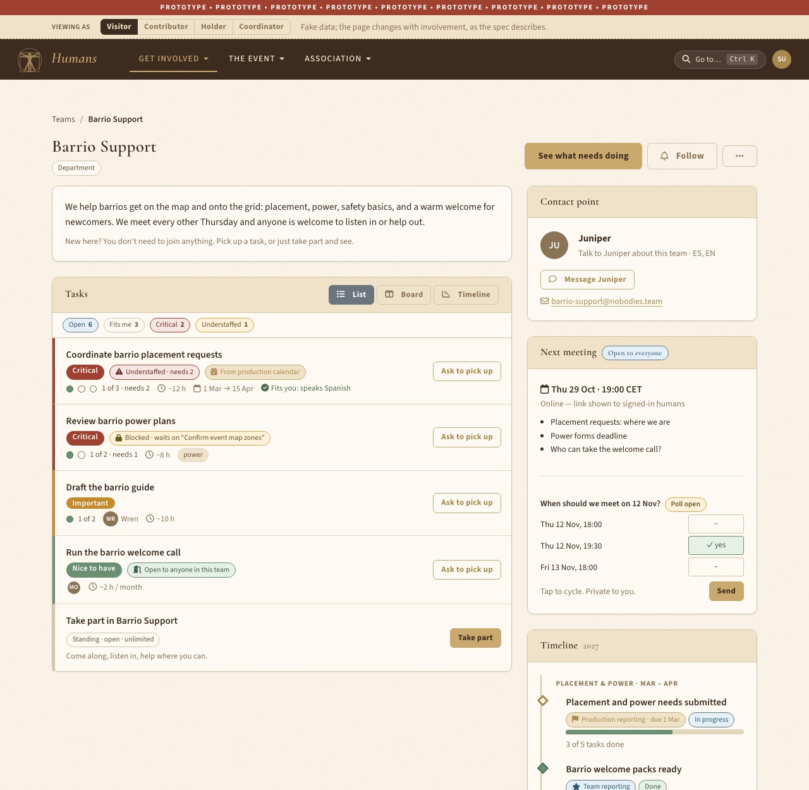
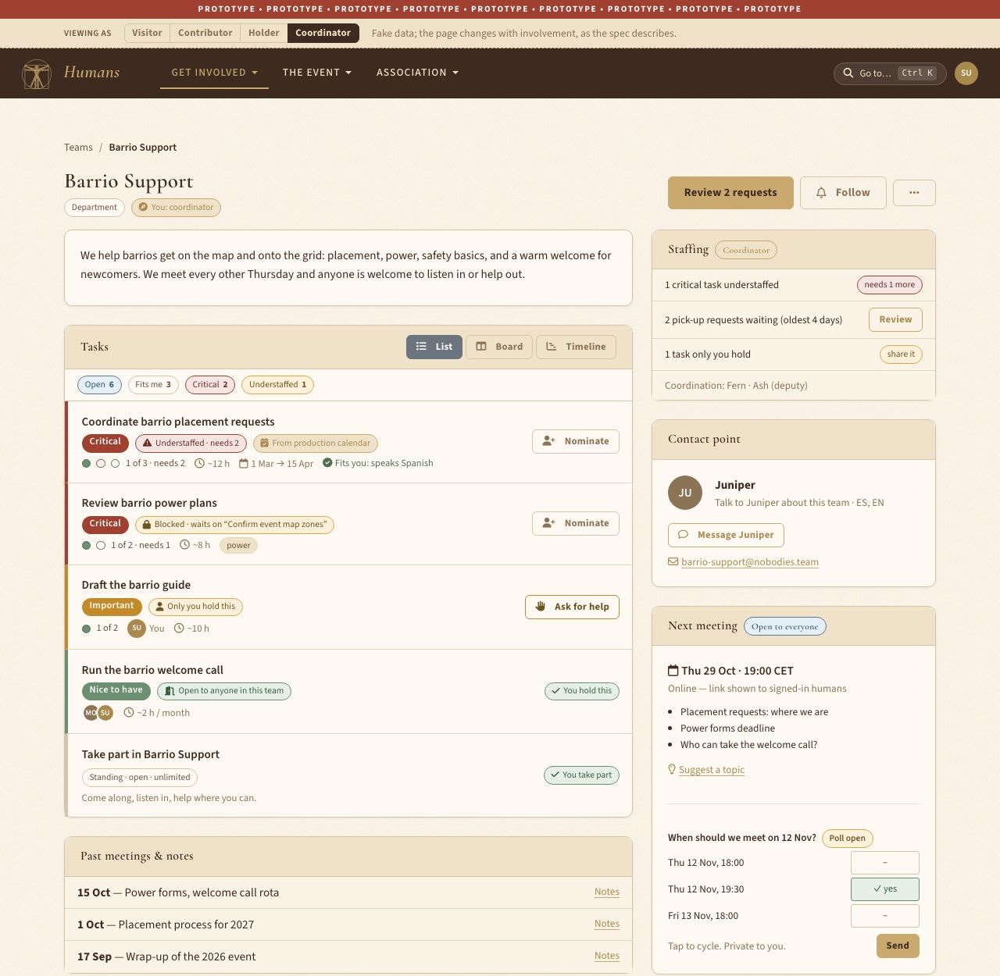
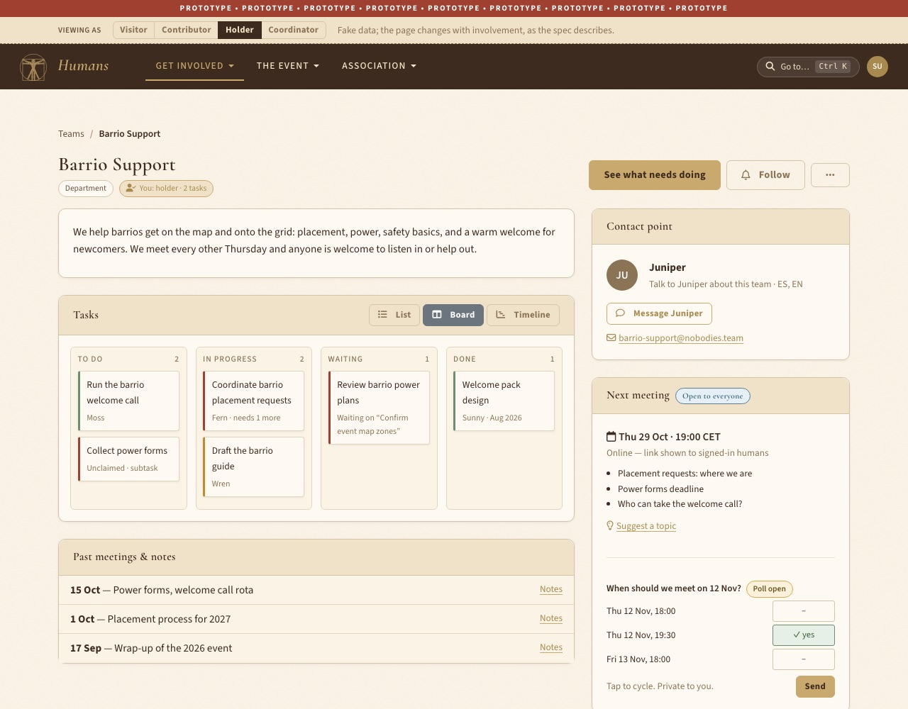

**Task page and Get involved**

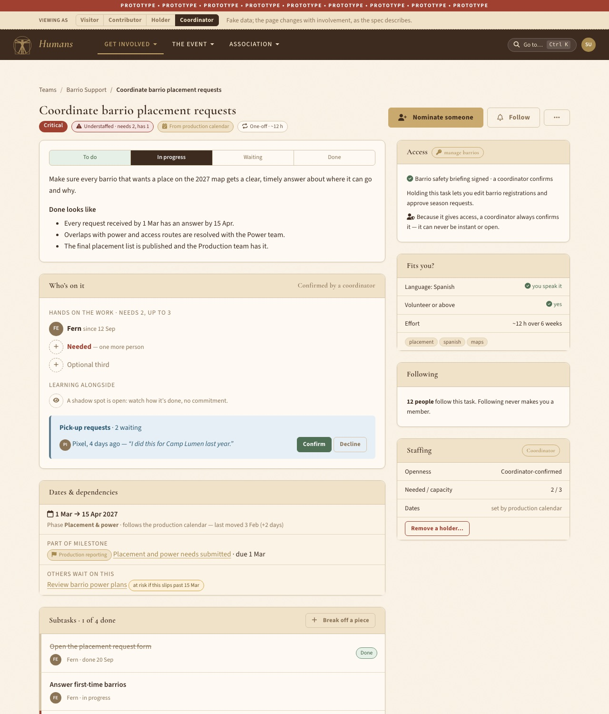
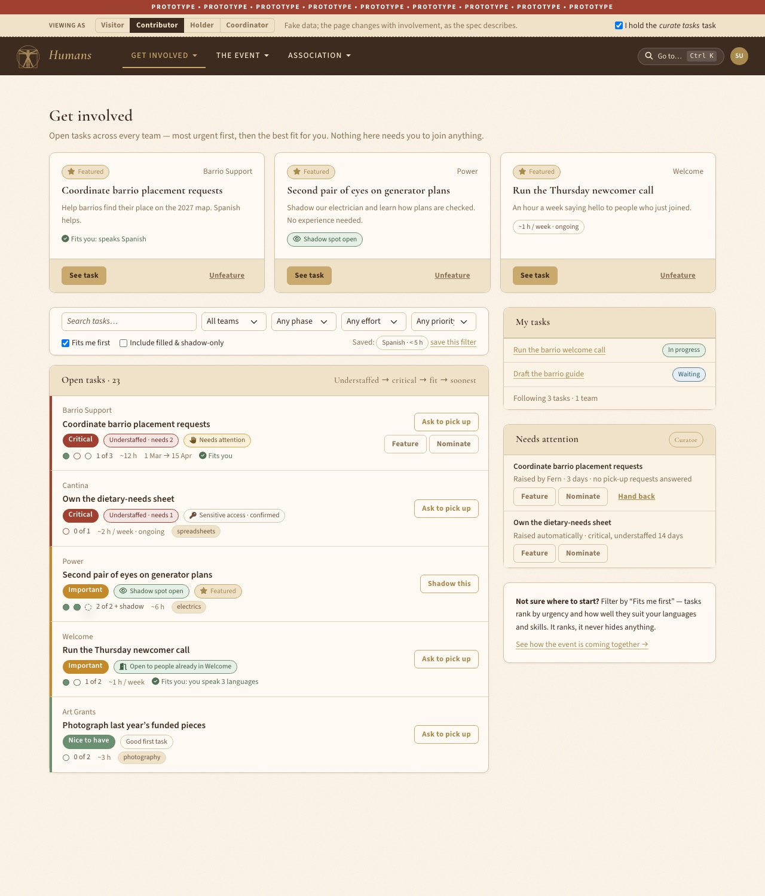

**Production view** (with the team-reporting layer switched on)

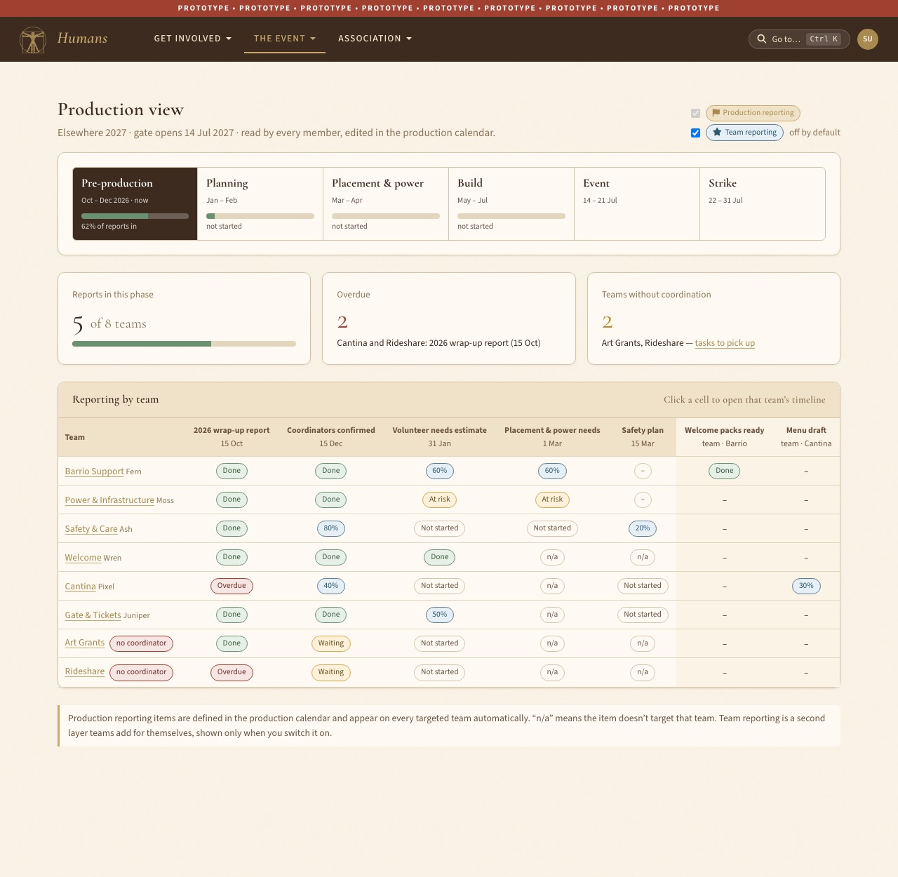

**Navigation** — group menu, go-to search, overview

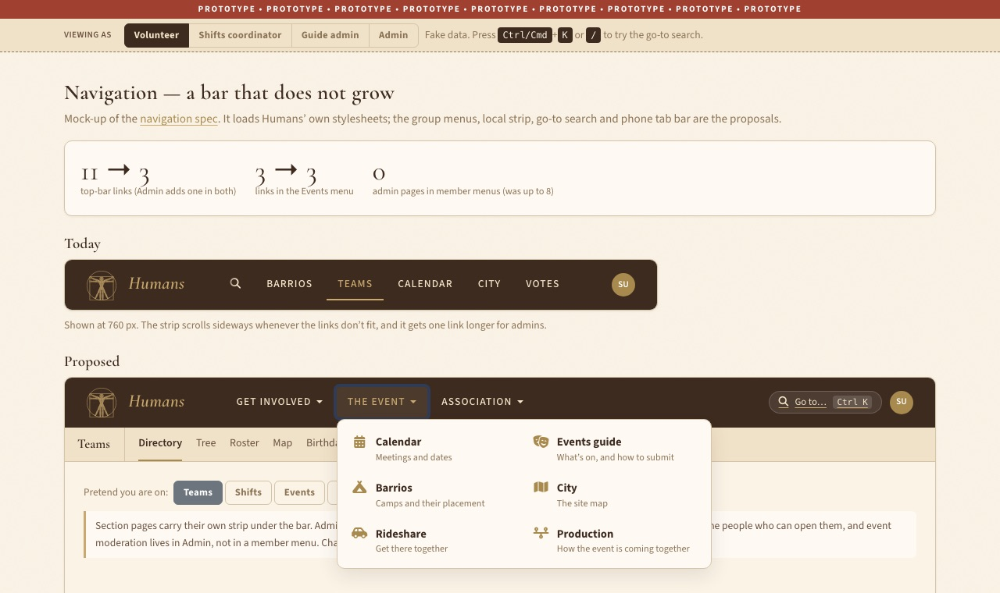
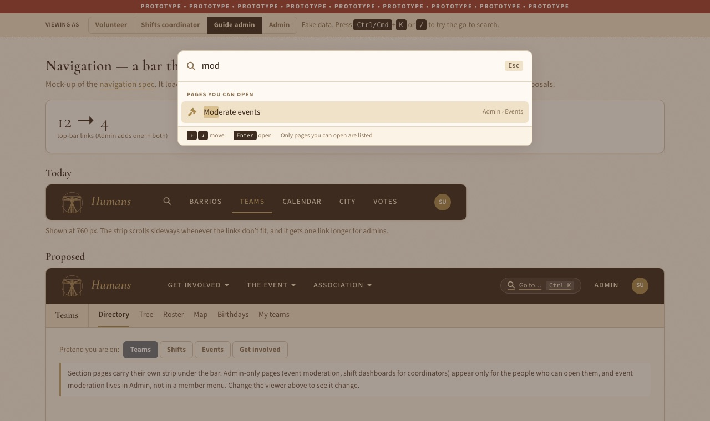
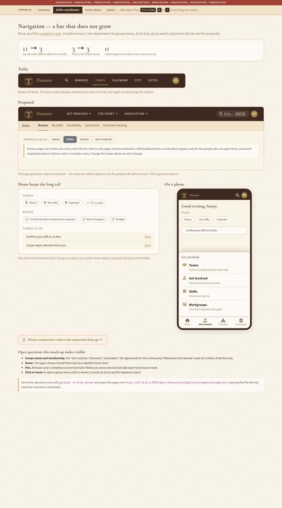

**Phones** — today next to proposed; then the proposed pages at phone width

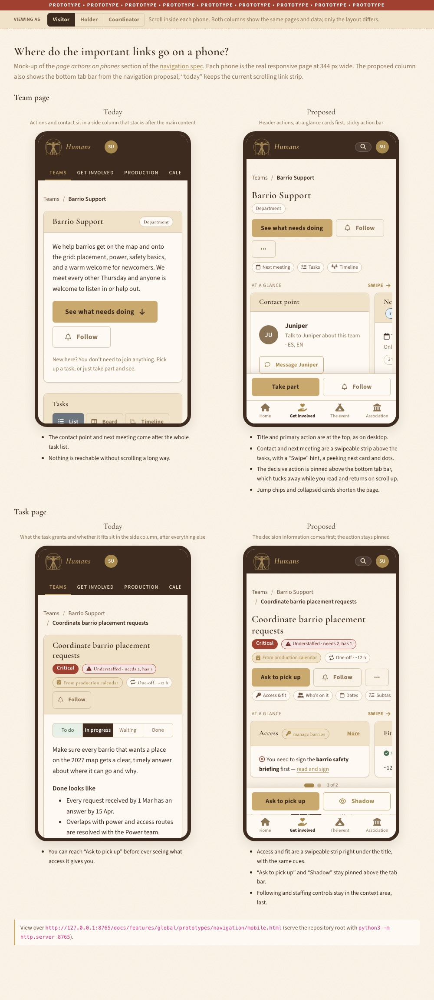

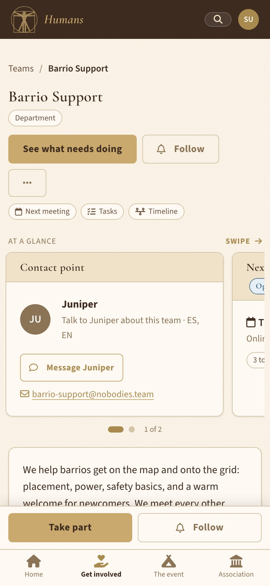 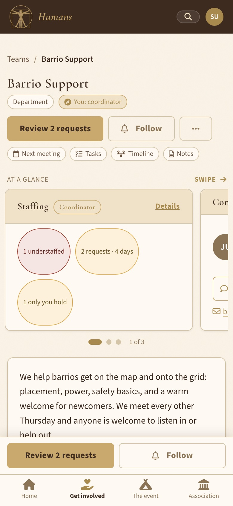 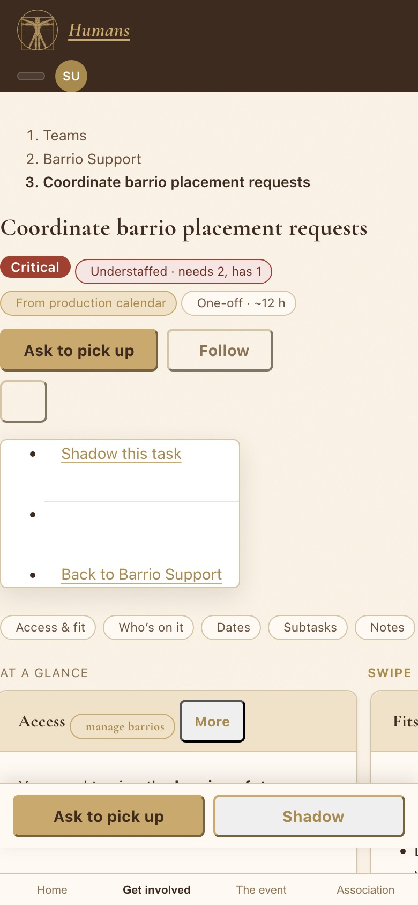 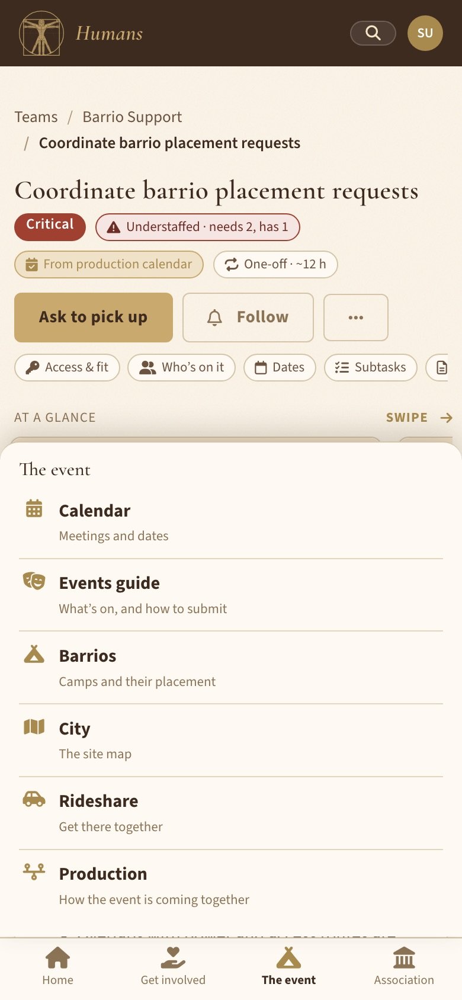
